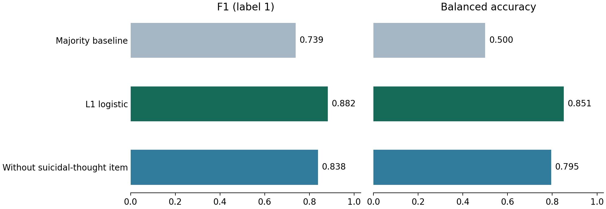
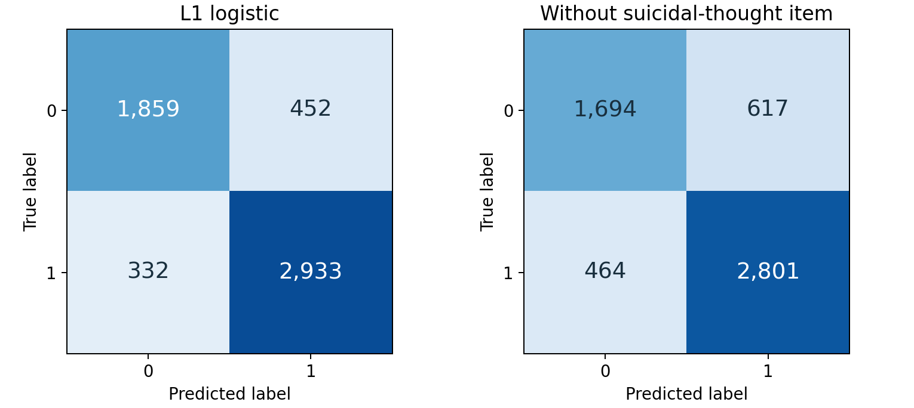

# Student depression classification

A tabular classification study comparing preprocessing choices and classifiers on the Student Depression Dataset. The repository contains the original Machine Learning coursework and a smaller, executable review of its final logistic regression model.

[Reviewed notebook](Student_Depression_Review.ipynb) · [Original coursework](MLProjectDiPilato.ipynb) · [Recorded review results](results/review.json)

## Results



| Model | F1, positive class | Accuracy | Balanced accuracy | ROC AUC |
| :--- | ---: | ---: | ---: | ---: |
| Majority-class baseline | 0.7386 | 0.5855 | 0.5000 | 0.5000 |
| L1 logistic regression | **0.8821** | **0.8594** | **0.8514** | **0.9290** |
| L1 logistic, without suicidal-thought item | 0.8382 | 0.8061 | 0.7955 | 0.8796 |

The review was rerun in November 2026 on 5,576 held-out rows. The original February 2025 notebook reported F1 **0.8791** and accuracy **0.8560**. Both use the same historical split; the revised result is a retrospective comparison, not a fresh independent test.

The suicidal-thought question accounts for a noticeable part of the predictive performance. Removing it lowers F1 from 0.8821 to 0.8382. Its timing relative to the target label is undocumented, so the full-feature score should not be interpreted as prediction of future onset.

## What the review changes

The original notebook explores Perceptron, logistic regression, random forest and XGBoost, including resampling and dimensionality reduction. The review concentrates on the final L1 logistic model:

- Corrects sleep-duration categories to their natural order.
- Fits imputation, encoding and scaling inside cross-validation pipelines.
- Selects regularization strength separately for the full and reduced feature sets with five-fold stratified cross-validation.
- Adds a majority-class baseline and computes each confusion matrix from the estimator it describes.



The original notebook remains available as the submitted work. Its exploratory search includes invalid oversampling candidates and a shifted XGBoost learning-rate distribution; those searches are not used by the reviewed models.

## Data and protocol

The [Student Depression Dataset](https://www.kaggle.com/datasets/hopesb/student-depression-dataset) contains 27,901 rows and 18 columns. Historical cleaning retains 27,880 rows, split into 22,304 training and 5,576 test examples with seed 30 and stratification. As part of the original missing-data exercise, the same randomly chosen 10% of rows are masked in four fields. The review preserves this protocol for comparison.

The target is the CSV's binary `Depression` label. Its assessment method and timing are not established in this project. There is no clinical or prospective validation, and the model is not a diagnostic tool. The notebook checks the input file's SHA-256 before fitting.

## Run the review

```bash
git clone https://github.com/pdmdp/student-depression-project.git
cd student-depression-project
python -m pip install -r requirements.txt
python -m jupyter lab Student_Depression_Review.ipynb
```

Run all cells from the repository root. The verified run used Python 3.14.4 and the numerical package versions pinned in `requirements.txt`. The original notebook has a separate, unpinned dependency list in `requirements-original.txt`; its full exploratory search was not rerun during this update.

To redraw the README figures from the saved review metrics:

```bash
python scripts/plot_results.py
```

## Author

**Matteo Pietro Di Pilato** · Machine Learning, Module 1, BSc in Artificial Intelligence, academic year 2024/25.

The [MIT license](LICENSE) covers the project code. The source dataset retains its own terms.
